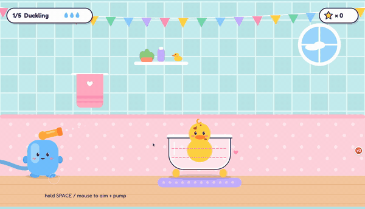
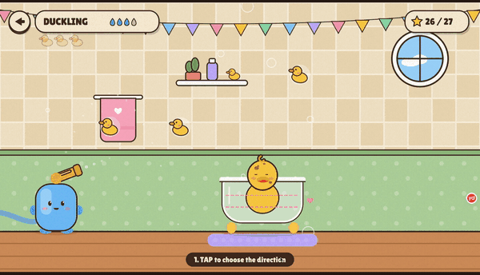
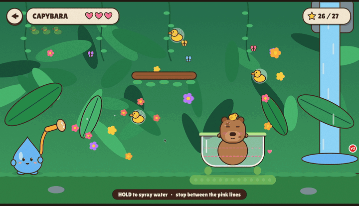
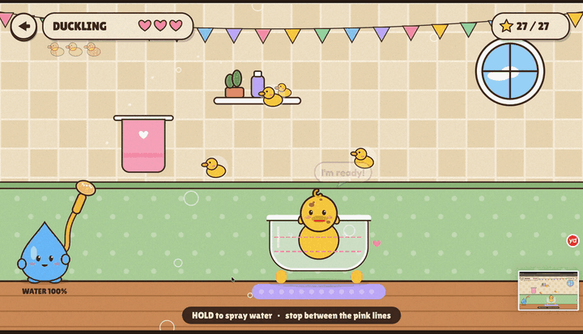

# Bath Time! — a one button game

Hello World · Xinyu (Aria) Hang

Nine animals from three places need a bath. Every animal wants a **different amount of water**,
has its own rule, and comes with a **fun fact** (some animals you may not know yet!).

## Week 8: the shower head (one part, improved)

For Week 8 I chose **Route A: improve an earlier project**. The one part I improved is the **shower head**:
how it aims, how strong the water is, and how much water you have.

### My goal (intention)

- **What I wanted to change:** two classmates played the game. One said the water felt **weak** ("no power").
  I also felt the game was slow, because the water never ran out.
  I wanted the water to feel **strong**, and every bath to have a **fixed amount of water**, so you have to think before you spray.
- **What I kept the same:** it is still a **one button** game (hold = spray, let go = stop), the **cute style**,
  the 9 animals and the islands.

My prompt format (from class):

> **I intend** to make the water feel stronger, and give each bath a fixed amount of water.
> **I will check by** holding the button for the same time before and after, and asking classmates to play.
> **I will preserve** the cute style and the one-button control.
> **I am not claiming** this is real water physics.

### How the shower head changed (mechanism)

| Version | Aim | Water | Folder |
| --- | --- | --- | --- |
| v2 (week 7) | hold = the hose swings **and** the power pumps at the same time | one splash | `backup-v2` |
| v3 | tap = **stop the direction**, then hold = power, let go = shoot (like golf) | a few splashes | `backup-v3-shots` |
| v4 | the shower head **swings by itself**, hold = water sprays | **endless** | `backup-v4-stream` |
| **v5 (now)** | the shower head swings by itself, hold = water sprays | **fixed amount** + **stronger** | this folder |

| v2 | v3 |
| --- | --- |
|  |  |

**Why the water felt weak:** the game picks the water strength for each level so that the water *just* reaches the tub.
So the water was always slow and floaty.

**What I changed:**
- The water is **1.45x faster**, and gravity for water is stronger by the same amount (1.45 x 1.45).
  So the water follows the **same path** as before (the levels and ducks still work), it just gets there **faster**.
- The little water-drop buddy is now the **water tank**: you can see the water go down inside it (and a WATER % number).
- Each bath has about **2.5x** the water the tub needs.
- More "punch": the shower head kicks back, a little mist, longer drops, bigger splashes.

### What I checked (evidence)

| | Before (v4) | After (v5) |
| --- | --- | --- |
| Duckling: water to the tub | 1.45 s | 1.00 s |
| Puppy: water to the tub | 0.93 s | 0.65 s |
| Hippo: water to the tub | 1.80 s | 1.25 s |
| Water in the tank | endless | about 2.5x what the tub needs |




What I saw and what I decided:
- **1.8x water** was tested first: a computer player had only 12% left on the Kitten. Too hard.
  **2.0x** still felt too small when I played. So I chose **2.5x**.
- With a fixed amount of water, I found the **end of a bath was confusing**: the bath ended 0.6 s after I let go,
  and I got 3 stars just for the ducks, even when the tub did not look full.
  So I changed it: the bath ends after a **3-2-1 countdown** (hold again = cancel), and the 3 stars are
  **clean + all 3 ducks + saved water (20% left)**.
- The foam step did not work at first: the normal water **cannot reach the animal's head**
  (it only lands in the front of the tub). So in the foam and rinse steps, the shower head uses a stronger setting.

**Not checked yet:** I did not test with many players yet, and I did not test every level on a phone.

### Other changes from classmate feedback

- A **tree trunk** or a **big leaf** bounces water back (Hippo, Big Ellie, Capybara).
- With more water, the tub **slides** (Rhino, Tapir).
- Animals have a **personality**: Big Ellie sprays water out with her trunk, the Dart Frog kicks water out.
- **Extra steps:** Puppy = water → foam → rinse. Hippo = water → green face mask (cucumbers!) → rinse.
- When the water runs out, the animal is **sad** or **laughs "oh no"** (only the grumpy Rhino gets angry).

### My decisions and credits

**My decisions:**
- Improve the **shower head** (not add a new game).
- **Fixed water** instead of a timer (a timer felt too stressful, endless water felt too slow).
- Stars = clean + ducks + saved water. The bath ends with a countdown, not only when the water is gone.
- **No "hot water" idea:** a classmate said the water could get too hot. I said no, because it feels like hurting the animals.
- **Friends, not angry:** the animals are our friends, so most of them are sad or laugh, not angry.
- Keep **one button** and the **cute style**.

**AI help (Claude):** I used Claude to read my code, find which code controls the water, write the code changes,
and test all 9 levels with a computer player. Claude suggested the "same path, faster water" method,
the first numbers (1.45x, 2.0x), and which animal gets which new feature. I played it and changed what I did not like.

A prompt I used (translated from Chinese, short):
> "Classmates said the water feels weak. I want each round to have a fixed amount of water,
> and some animals should get angry and jump if the water runs out. Keep it one button."

The first AI answer (short): it found that the water strength is fixed for each level and chosen to *just* reach the tub,
so it made the water faster but kept the same path, and made the water-drop buddy into a tank that empties.

**Feedback:** two classmates in Hello World. **Code libraries:** p5.js, qrcode.js (see Files below).

### My next question

- Is 2.5x water the right amount for everyone, or only for me?
- Are the foam and mask steps clear for a new player without my help?
- Question for a classmate: is the countdown too long or too short?

---

## One button

**Space**, **click** or **tap** is the only button.

| Where | Tap | Hold |
| --- | --- | --- |
| Menus (cover, map, animal list) | next choice | choose |
| Anywhere | the round ◀ button (top left) or **ESC** goes back | |
| In a bath | — | **water sprays** from the shower head. **Let go** = it stops |
| Anywhere | **M** = music on / off | |

The shower head swings slowly up and down by itself. Wait until it points at the tub,
**hold** to spray, and **let go** when the water is between the two pink lines.
A faint dotted line shows where the water will go.

**The water tank is not endless.** The little water-drop buddy IS the tank: you can see the water
inside it go down (and a WATER % number). Every bath has a fixed amount of water (about 2x what the tub needs).
When the tank is almost empty, the animal warns you. If the tank is empty and the bath is not ready,
the animal gets **angry** (stomp stomp!) and you try again.

Mistakes (too much water, a splash on the kitten's face, hitting the capybara's bird)
cost **one heart**, not the whole bath. You have **3 hearts**.

## Three modes

- **ISLAND TRIP** — 3 islands, 9 animals. Each has its own rule and a fun fact.
- **BATH RUSH** — endless! Tubs ride on a moving belt. Fill each one before it leaves.
  Clean animals in a row = **COMBO** (up to x5). Hit floating ducks for +50.
  The belt gets faster. Your **best score** is saved.
- **VS · 2 PLAYERS** — take turns on the same 3 animals. Points = 100 for clean + 100 per duck + 50 per heart left.

## Rubber ducks (like Cut the Rope)

Every bath has **3 rubber ducks** floating in the air. Sweep the water stream across them to collect them.
But careful: water that falls in the tub counts, so don't overfill it!

## Stars and the end of a bath (week 8)

- The bath is done when the water is **between the pink lines** and you **stop for 2.5 seconds**.
  A **3-2-1 countdown** shows over the tub. Hold again = the countdown stops (so a mistake is not the end).
- If the tank is empty and the bath is not ready, the animal gets angry and you try again.
- **3 stars:** ★ CLEAN (you always get it when you win) · ★ all **3 ducks** · ★ **saved water** (20% or more left in the tank).
  The result card shows each star and what it means.

## Juice

Each drop in the tub goes "plip" a little higher as the tub fills. The water sprays with a soft "shhh",
the screen shakes on big moments, confetti pops on a clean bath, and a little tune plays (made with code).

## Photo album

When an animal is clean, the game says **"SAY CHEESE!"** and takes a **photo** (with a flash).
The photo shows up on the result card like an instant photo, and it is saved in the
**PHOTO ALBUM** (choose ALBUM on the island map). Photos are saved in the browser too.

## Your animal friends play with you

- Their **eyes follow** the water (and look at you when you wait).
- When you **charge** the water gun, they get excited and wiggle.
- When you catch a duck they **hop, cheer and talk** ("Woof woof!", "Ribbit!", "Toot toot!"),
  and every animal has its own little **voice**. Catch 2 or 3 ducks with one splash: **DOUBLE! / TRIPLE!!**
- Miss everything and they laugh: "Hehe, missed!". Wait too long and they call: "Over here!"
- A clean animal does a **happy dance**, and the water tank buddy dances too.

## The islands and animals

| Island | Animal | What makes it special |
| --- | --- | --- |
| Cozy Home | Duckling | Easy. Ducks love a splash on the head |
| | Puppy | Very muddy: **water → FOAM on the head → RINSE** |
| | Kitten | She **hides and peeks out** — a splash on her face when she peeks = -1 heart |
| Sunny Savanna | Hippo | **water → green FACE MASK (cucumbers!) → RINSE**. A **tree trunk** bounces water back |
| | Rhino | A MUD bath + a **big rock** in the way. More water = the tub **slides** in the mud |
| | Big Ellie | Huge tub far away + **wind**. She **sprays water out** with her trunk (she warns you first). A tree bounces water |
| Rainforest | Capybara | Don't hit the **bird** (-1 heart, it flies away and comes back) + a **branch**. A **big leaf** bounces water |
| | Dart Frog | The tub **floats around** — and the frog **kicks water out** (he warns you first) |
| | Tapir | Fill it almost to the top + a **stump** + **wind** + the tub **slides** |

## Play on a phone (QR code)

When the game is online (GitHub Pages), the cover shows a **QR code**.
Classmates scan it and play on their own phones — tapping the screen is the one button.

## Art direction

- **Cover**: sticker style (thick yellow + blue outlines, halftone dots, swirls)
- **Map**: little floating islands, one for each place
- **Animal list + fact card**: warm, flat, hand-drawn look with dark brown outlines,
  a sunburst badge and chunky buttons
- A light **paper grain** on top of everything

## How to run

Open the folder in VS Code → select `index.html` → **Go Live**.
Or open the GitHub Pages link. It works on a phone too (tap = the button).

## How the code works

The game is a **state machine**:

```
cover → map → island → intro (fun fact) → aim (hold = spray) → result → island …
cover → rush → rushOver → rush …
cover → (VS) intro → aim → result → next player … → vsRound → … → vsEnd
```

Files:

- **`sketch.js`** — settings, the list of islands and animals (`WORLDS`), the `Game` class (state machine, rules, stars) and the one-button input
- **`things.js`** — `Hose` (swing + pump + guide line), `Drop` (gravity), `Tub` (water level, mud), `Bubble` (bubbles, splashes, hearts, speech), `Sounds` (Web Audio, no sound files)
- **`challenges.js`** — the ducks (`Duck`, `placeDucks`), `simulateArc` (one drop without randomness: used for the guide, the last-shot trail and to make sure every duck CAN be reached), obstacles, wind and the cold-water timer
- **`week8.js`** — week 8 changes: bouncy tree trunks and leaves, sliding tubs, animal pranks, and the water → foam/mask → rinse steps
- **`rush.js`** — BATH RUSH: the moving belt, combo, hearts and best score
- **`music.js`** — a little looping tune made with Web Audio (bass + chords + random notes from a pentatonic scale)
- **`animals.js`** — `Animal`: every animal is drawn with simple shapes, with moods (idle, happy, wet, scared, sad) and mud spots that disappear when it is clean
- **`screens.js`** — cover, island map, animal list, fact card, the three backgrounds, HUD and result card

Still backgrounds are drawn once into hidden layers (`createGraphics`) so the game runs fast.
Animal heads get their outline by drawing a one-color copy of the head 16 times in a circle around it.

To add a new animal: add it to `WORLDS` in `sketch.js` (tub size, water per splash,
perfect zone, rule, fact) and draw its head in `animals.js`.

## Files

```
bath-time/
├── index.html
├── sketch.js
├── things.js
├── challenges.js
├── week8.js
├── rush.js
├── music.js
├── animals.js
├── screens.js
├── style.css
├── libraries/
│   ├── p5.min.js   (p5.js v1.4.1)
│   └── qrcode.js   (QR code generator by Kazuhiko Arase, MIT license)
└── README.md
```
